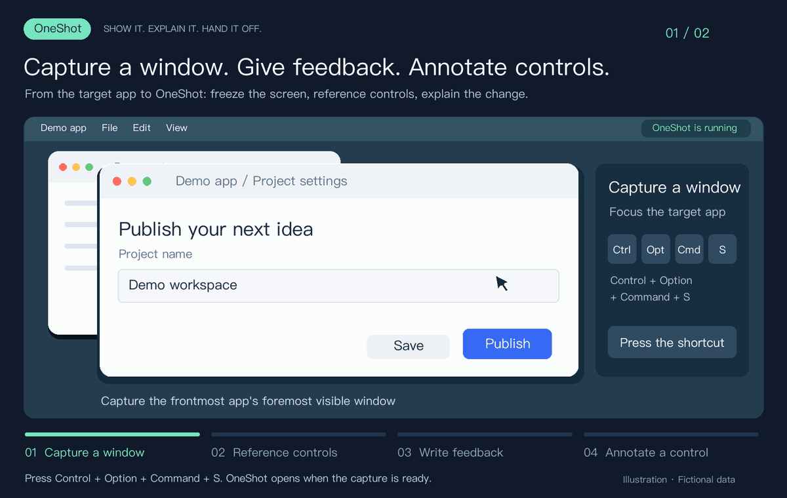
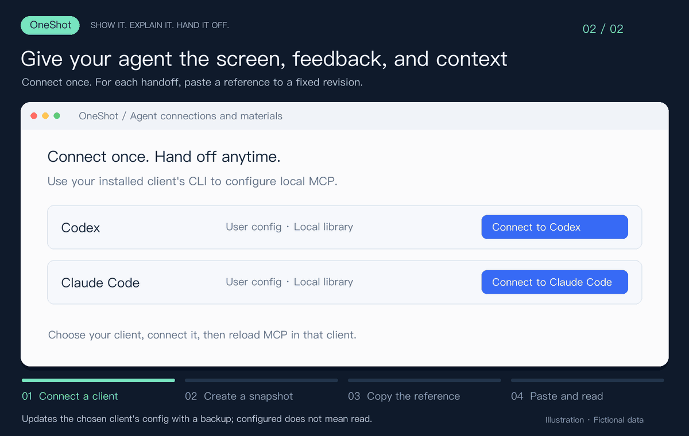

# OneShot

**Give your agent the screen, your feedback, and the context.**

OneShot is a native macOS window capture and annotation tool. Capture a window with a shortcut, reference controls in your feedback, and hand the screenshot and captured UI context to your agent. Use it for UI changes, bug reports, and design feedback.

[Latest release](https://github.com/YTwsy/OneShot/releases/latest) · [简体中文](README.md) · [Getting started (中文)](docs/getting-started.md) · [Agent connection (中文)](docs/agent-handoff.md) · [Development (中文)](docs/development.md) · [Changelog](CHANGELOG.md)

**macOS 14+ · Apple Silicon · Native SwiftUI · Local capture · MIT · v0.1.0**

## Make feedback specific



*Focus a window → press ⌃⌥⌘S to capture → reference controls and write feedback → select a control and describe the change. Illustrated with fictional data and translated UI labels, not a screen recording. [Static image](docs/media/annotate-workflow.en.png).*

- **Capture context with the image.** Keep the screenshot, Accessibility (AX) controls, OCR text, and the individual capture results.
- **Point to actual controls.** Select a control in the image or search with `@`. References such as `R1` and `R2` link feedback to the frozen controls. A sentence can reference multiple controls.
- **Add visual annotations.** Use numbers, arrows, rectangles, and text. Save a `.oneshot` project to continue editing later.
- **Connect once, hand off repeatedly.** A bundled read-only MCP server supports Codex and Claude Code. A folder export is available for other agents.

## One round trip

1. **Capture.** Keep OneShot running, switch to your target app, and press **⌃⌥⌘S** (Control + Option + Command + S). A three-second countdown is also available.
2. **Describe.** Choose “写反馈” (Write feedback), explain the change, and use “引用控件” (Reference control) or `@` to reference a captured control.
3. **Annotate.** Add arrows, rectangles, numbers, or text as needed. Editing the frozen snapshot does not interact with the source app.
4. **Connect.** Open **OneShot → Agent 连接与材料** (Agent connections and materials), connect your installed Codex or Claude Code client, and reload MCP in that client.
5. **Hand off.** Click **“交给 Agent”** (Hand to Agent, ⇧⌘E). OneShot creates a fixed revision and copies the reading instructions. **Paste the reference into your agent conversation.**

A capture can be handed off without annotations. A handoff includes unsaved edits but does not replace saving the project. Later handoffs create new revisions; existing references keep pointing to their original content.

## What the agent receives



*Illustrated workflow with translated UI labels; the conversation is a generic example, not an actual client interface. [Static image](docs/media/agent-handoff-workflow.en.png).*

A reference such as `OS-0123456789AB@1` lets a connected agent read:

| Material | Purpose |
| --- | --- |
| Feedback and ordered control references | Understand the requested change and its targets |
| Annotated and original images | Locate visual details and inspect image regions |
| Frozen AX nodes and captured context | Inspect control roles, text, state, and hierarchy |
| Individual screenshot, AX, and OCR results | Distinguish success, missing data, failures, and truncation |

Start with `read_handoff`, then use `read_details` or `read_image` as needed. **File → 导出 Agent 文件夹** (Export Agent folder) exports `AGENT.md`, `handoff.json`, `annotated.png`, and an editable `source.oneshot/` project. See the [MCP guide (中文)](docs/agent-handoff.md).

## Installation and status

Requires **macOS 14+ and Apple Silicon (arm64)**. The current stable release is **0.1.0 (build 12)**, with manual download-and-replace updates.

Download the DMG from [GitHub Releases](https://github.com/YTwsy/OneShot/releases/latest), read the release notes, and verify its SHA-256 before dragging `OneShot.app` into Applications. The app bundles the capture helper and MCP server; package users do not need Swift. You can also [build from source](docs/development.md).

**0.1.0 uses Apple Development signing and is not notarized by Apple.** The stable release channel does not change this signing status. Apple Development signing is not Developer ID distribution signing. Check the specific package's release notes and manifest for its status. Follow [Apple's instructions for opening an app from an unknown developer](https://support.apple.com/guide/mac-help/open-a-mac-app-from-an-unknown-developer-mh40616/mac) if macOS blocks first launch; do not disable system-wide security checks.

Capture requires **Screen Recording** and **Accessibility** permissions. OneShot explains and requests them separately; you approve them in macOS. See [permissions (中文)](docs/permissions.md).

## Data and limitations

- **Local storage, explicit handoff.** Only snapshots you hand off enter the MCP library. Drafts are not exposed automatically. OneShot does not upload materials itself; the agent client's policies govern subsequent processing.
- **Review the entire capture.** Materials can include unannotated areas, window titles, and AX/OCR text. Cropping and blur redaction are not implemented; remove sensitive content in the source app and capture again.
- **References identify revisions.** They are local locators, not client-specific access tokens. Revocation blocks future MCP reads but cannot recall content already returned.
- **Capture has limits.** OneShot targets the frontmost app's foremost visible normal window, not every window or a freely selected screen region. AX depends on what each app exposes and does not guarantee a complete document.
- **Screenshot, AX, and OCR are separate reads.** They are not an atomic snapshot. OCR is not control state. The MCP server is read-only: no capture, clicks, writes, or network access.

Closing the editor leaves the menu bar and shortcut active; ⌘Q quits. App compatibility, first-run permissions, and permission continuity across upgrades still require tests on real Macs.

## Development and contribution

Build with macOS 14+ and Swift 6. The project uses SwiftPM and has no third-party Swift package dependencies.

```sh
zsh scripts/test.sh
zsh scripts/build-probe.sh
zsh scripts/build-editor.sh
open '.build/OneShot Editor.app'
```

[Development and CLI](docs/development.md) · [Packaging](docs/releasing.md) · [Contributing](CONTRIBUTING.md) · [Security](SECURITY.md) · [Public release checklist](docs/public-release-checklist.md)

## License and references

[MIT License](LICENSE). Independently implemented using macOS CoreGraphics, ScreenCaptureKit, Accessibility, and Vision.

Interaction and capability references include [Pinpoint](https://github.com/croustibat/Pinpoint), [open-source Appshots](https://github.com/Shahfarzane/appshots), [Remarc](https://github.com/metedata/Remarc), and [Peekaboo](https://github.com/openclaw/Peekaboo). These references do not imply their code or assets are bundled with OneShot. OneShot does not include or call Codex's proprietary AppShot service.
