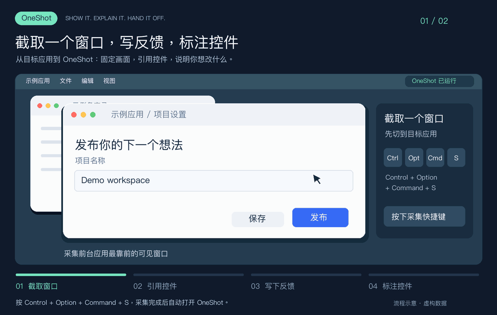
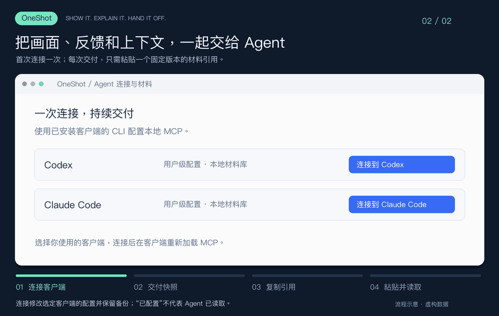

# OneShot

**把画面和你的意见，一起交给 Agent。**

OneShot 是 macOS 上的窗口采集与标注工具。按下快捷键，固定当前窗口；点选控件、写下修改意见，再把截图、反馈和界面上下文一起交给 Agent。适合 UI 调整、问题复现和设计反馈。

[下载最新版](https://github.com/YTwsy/OneShot/releases/latest) · [English](README.en.md) · [安装与使用](docs/getting-started.md) · [连接 Agent](docs/agent-handoff.md) · [开发与构建](docs/development.md) · [更新记录](CHANGELOG.md)

**macOS 14+ · Apple Silicon · 原生 SwiftUI · 本地采集 · MIT · v0.1.0**

## 从“这里改一下”到明确的反馈



*切到目标窗口 → 按 ⌃⌥⌘S 采集 → 引用控件、写反馈 → 点选控件、填写修改意见。使用虚构界面与数据的流程示意，并非实机录屏。[查看静态图](docs/media/annotate-workflow.png)。*

- **画面带着上下文。** 同时保留窗口截图、辅助功能（AX）控件信息、OCR 文字，以及各自的采集状态。
- **反馈可以指向具体控件。** 在截图中点选，或输入 `@` 搜索；`R1`、`R2` 引用与画面双向定位，一句话可以引用多个对象。
- **保留熟悉的图形标注。** 编号、箭头、方框和文字用于补充说明；`.oneshot` 项目可以保存后继续编辑。
- **一次连接，反复交付。** 内置只读 MCP，支持连接 Codex / Claude Code，也可以导出文件夹供其他 Agent 使用。

## 一轮使用

1. **采集。** 保持 OneShot 运行，切到目标应用，按 **⌃⌥⌘S**（Control + Option + Command + S）。也可以点击“3 秒后采集”。
2. **描述。** 点击“写反馈”，说明想改什么；点击“引用控件”或输入 `@`，将意见绑定到这次采集的控件。
3. **标注。** 按需添加箭头、方框、编号或文字。编辑的是冻结快照，不会操作原应用。
4. **连接。** 首次打开 **OneShot → Agent 连接与材料**，连接到已安装的 Codex 或 Claude Code，然后在客户端重新加载 MCP。
5. **交付。** 点击 **“交给 Agent”**（⇧⌘E），生成固定版本并复制读取说明；**将引用粘贴到 Agent 对话中**。

没有反馈时也可以交付整次采集。交付包含尚未保存的编辑，但不代替保存项目；再次交付会生成新版本，旧引用保持不变。

## Agent 收到什么



*流程示意，Agent 对话为通用示例，并非某个客户端的实际界面。[查看静态图](docs/media/agent-handoff-workflow.png)。*

将类似 `OS-0123456789AB@1` 的材料引用交给 Agent 后，它可以通过本地 MCP 读取：

| 内容 | 用途 |
| --- | --- |
| 反馈原文与有序控件引用 | 理解你要改什么，以及在说哪个控件 |
| 标注图与原始截图 | 对照视觉位置，按需读取局部图像 |
| 冻结 AX 节点及已采集的上下文 | 查看控件角色、文字、状态与层级 |
| 截图、AX、OCR 的独立状态与诊断 | 区分成功、缺失、失败和截断 |

入口是 `read_handoff`，细节通过 `read_details` / `read_image` 继续读取。也可用 **文件 → 导出 Agent 文件夹**，得到 `AGENT.md`、`handoff.json`、`annotated.png` 和可继续编辑的 `source.oneshot/`。配置与接口说明见[交付与 MCP](docs/agent-handoff.md)。

## 安装与当前状态

支持 **macOS 14+、Apple Silicon（arm64）**。当前正式版本为 **0.1.0（build 12）**，采用手动下载替换更新。

从 [GitHub Releases](https://github.com/YTwsy/OneShot/releases/latest) 下载 DMG，阅读版本说明并核对 SHA-256，再把 `OneShot.app` 拖到 Applications 打开。单个 App 内置采集组件与 MCP，使用安装包不需要 Swift 工具链。也可以[从源码运行](docs/development.md)。

**0.1.0 使用 Apple Development 签名，未经 Apple 公证。** 正式版本号不改变签名状态；Apple Development 也不等同于 Developer ID 分发签名。具体包的状态以其发布说明与构建清单为准。macOS 可能阻止首次打开，请按 [Apple 的应用打开说明](https://support.apple.com/guide/mac-help/open-a-mac-app-from-an-unknown-developer-mh40616/mac)处理，不要关闭整机安全检查。

首次采集需要**屏幕录制**与**辅助功能**权限。应用分别说明并请求这两项权限，批准由你在系统中完成。详见[安装与使用](docs/getting-started.md)、[权限说明](docs/permissions.md)。

## 数据与能力边界

- **本地保留，明确交付。** 只有点击“交给 Agent”的快照进入 MCP 材料库，未交付采集和草稿不会自动暴露。OneShot 不自行上传材料；Agent 读取后的数据处理由该客户端决定。
- **分享前检查完整上下文。** 材料可能包含未标注区域、窗口标题、AX / OCR 文字。目前没有裁切和模糊遮挡工具；在源应用移除敏感信息后重新采集。
- **引用绑定版本。** 引用是本机定位信息，不是客户端专属权限令牌。撤销会阻止后续 MCP 读取，无法收回已经返回给 Agent 的内容。
- **采集范围有边界。** 当前目标为前台应用最靠前的可见普通窗口；不支持自由选区或一次采集整个应用的所有窗口。AX 内容取决于应用实际暴露的信息，不保证完整文档。
- **截图、AX 和 OCR 独立读取。** 它们不是原子快照；OCR 不能替代控件状态。MCP 只读，不采集、点击、写入或访问网络。

关闭编辑窗口后，菜单栏与快捷键继续运行；⌘Q 完全退出。应用兼容性、首次授权和升级权限保持仍需实机验证，自动测试不能代替这些验收。

## 开发与参与

使用 macOS 14+ 和 Swift 6 工具链，SwiftPM 构建，无第三方 Swift 包依赖。

```sh
zsh scripts/test.sh
zsh scripts/build-probe.sh
zsh scripts/build-editor.sh
open '.build/OneShot Editor.app'
```

[开发与 CLI](docs/development.md) · [构建与发布](docs/releasing.md) · [贡献指南](CONTRIBUTING.md) · [安全反馈](SECURITY.md) · [公开发布检查表](docs/public-release-checklist.md)

技术说明：[编辑器](docs/annotation-editor.md)、[快捷键采集](docs/shortcut-capture.md)、[采集完整度](docs/capture-baseline.md)。历史调查和验证报告的入口见[开发文档](docs/development.md#历史调查与验证)。

## 许可证与参考

采用 [MIT License](LICENSE)。基于 macOS 的 CoreGraphics、ScreenCaptureKit、Accessibility 与 Vision 独立实现。

交互和能力参考：[Pinpoint](https://github.com/croustibat/Pinpoint)、[开源 Appshots](https://github.com/Shahfarzane/appshots)、[Remarc](https://github.com/metedata/Remarc)、[Peekaboo](https://github.com/openclaw/Peekaboo)。这些链接不表示其代码或资源被打包进 OneShot。OneShot 不包含或调用 Codex 的专有 AppShot 服务。
